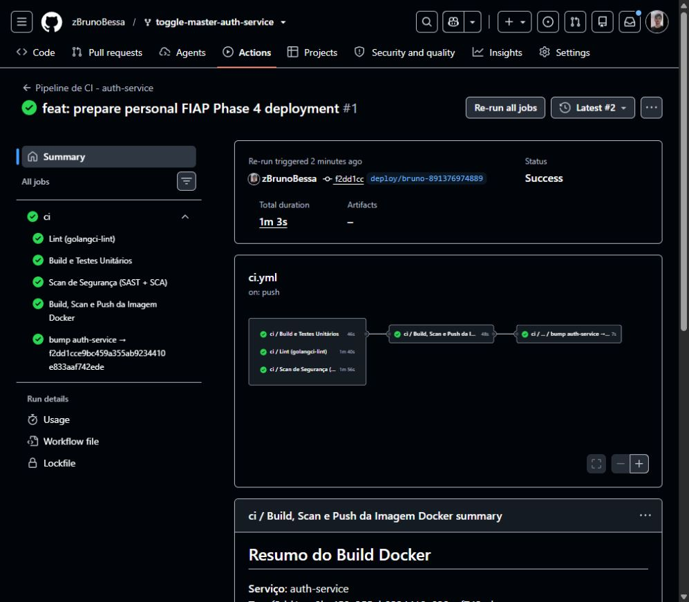
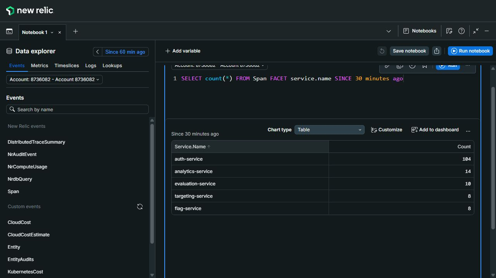
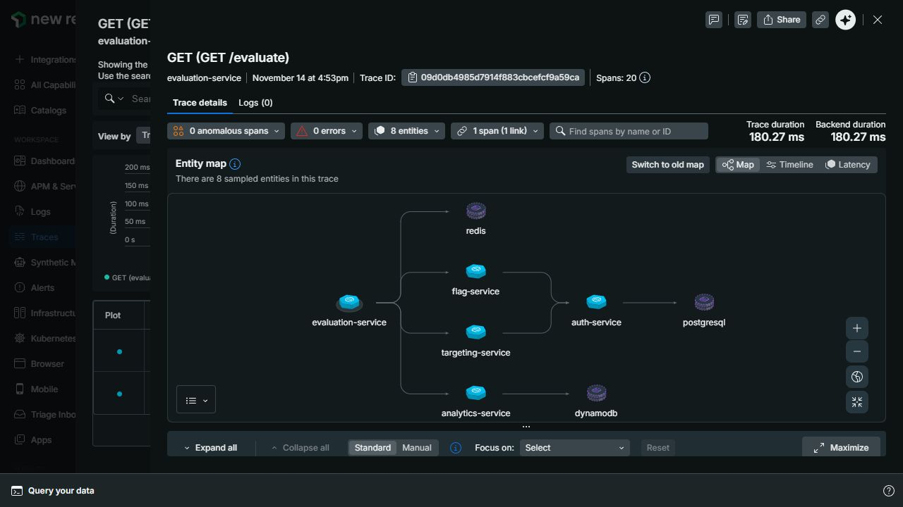

# Validação da implantação pessoal — Bruno

Data: 14/11/2026. Horários abaixo em UTC.

## Ambiente

- AWS Academy Learner Lab: conta 891376974889, região us-east-1.
- EKS: toggle-master-dev-eks, Kubernetes 1.35, dois nós t3.large.
- Infraestrutura provisionada com Terraform: VPC, EKS, EBS CSI/gp3, ECR, três bancos PostgreSQL, Redis, DynamoDB e SQS/DLQ.
- Estado remoto Terraform: S3 versionado e criptografado, com bloqueio de estado.
- GitHub pessoal: zBrunoBessa. Branch de implantação: deploy/bruno-891376974889.
- Repositórios: toggle-master-infra, toggle-master-ci e os cinco toggle-master-{auth,flag,targeting,evaluation,analytics}-service.
- As alterações publicadas pertencem às cópias pessoais. O ambiente do grupo usa outra conta.

## CI/CD e GitOps

Os cinco pipelines concluíram com sucesso, incluindo os jobs de build, verificações de segurança, publicação no ECR e atualização de imagem no GitOps:

| Serviço | Execução |
|---|---|
| Auth | https://github.com/zBrunoBessa/toggle-master-auth-service/actions/runs/43615742177 |
| Flag | https://github.com/zBrunoBessa/toggle-master-flag-service/actions/runs/43615745935 |
| Targeting | https://github.com/zBrunoBessa/toggle-master-targeting-service/actions/runs/43615748157 |
| Evaluation | https://github.com/zBrunoBessa/toggle-master-evaluation-service/actions/runs/43615749600 |
| Analytics | https://github.com/zBrunoBessa/toggle-master-analytics-service/actions/runs/43615753457 |

O CI valida a conta AWS antes de publicar as imagens. Os cinco repositórios usam os secrets BRUNO_AWS_ACCESS_KEY_ID, BRUNO_AWS_SECRET_ACCESS_KEY, BRUNO_AWS_SESSION_TOKEN e BRUNO_GITOPS_TOKEN. O token GitOps foi reduzido a Contents: Read and write somente no repositório pessoal de infraestrutura; expira em 21/11/2026. As credenciais AWS temporárias precisam ser atualizadas quando a sessão do Learner Lab expirar.

As 14 Applications do Argo CD atingiram Synced/Healthy. As imagens usam tags do commit, e a branch de implantação está configurada no Terraform/Argo CD.

## Validação funcional e observabilidade

- Criação da flag fiap-fase4-demo: HTTP 201.
- Criação da regra com 100% de habilitação: HTTP 201.
- GET /evaluate com user_id=fiap-demo-001 e flag_name=fiap-fase4-demo: HTTP 200, resultado true.
- Prometheus recebeu spanmetrics dos cinco serviços e métricas HTTP dos quatro serviços HTTP; analytics é consumidor assíncrono.
- Loki recebeu logs dos cinco serviços pela coleta OpenTelemetry, com o label k8s_namespace_name=toggle-master.
- Grafana: API de saúde com database=ok; datasources Prometheus, Loki e Alertmanager presentes. Dashboard ToggleMaster Overview provisionado.
- As 11 consultas do dashboard retornaram success e dados: CPU, memória, requisições, erros, latência e logs. O painel de ingress foi corrigido para agrupar por exported_service.
- New Relic, conta 8736082: spans recebidos dos cinco serviços.
- Trace 09d0db4985d7914f883cbcefcf9a59ca: GET /evaluate, 20 spans, duração 180,27 ms, zero erros, cinco serviços e oito entidades incluindo Redis, PostgreSQL e DynamoDB.

## Falha controlada e self-healing

1. Tráfego contínuo de aproximadamente 5 req/s em /validate, inicialmente HTTP 200.
2. Ativação de /admin/chaos nas duas réplicas do auth-service; respostas HTTP 500 observadas.
3. Regra ToggleMasterHigh5xxRate: razão de erros acima de 5%, janela de 2 minutos, sustentada por 1 minuto, com tráfego mínimo de 0,1 req/s.
4. Pending a partir de 17:12:10; Firing às 17:13:10.
5. Alertmanager enviou o alerta ao Discord, PagerDuty e webhook de self-healing.
6. Às 17:13:40 o receptor executou o patch de rollout restart, aceito pelo Kubernetes.
7. Duas novas réplicas ficaram Ready e o tráfego voltou a HTTP 200, sem intervenção manual para remover a falha.
8. O alerta terminou às 17:16:10. O Discord exibiu RESOLVED às 17:18, após o intervalo de agrupamento de cinco minutos.

O self-healing restringe os deployments permitidos e aplica cooldown de 300 segundos. A confirmação do patch foi complementada pela observação dos novos UIDs dos pods e pela recuperação HTTP, evitando confundir um patch aceito com recuperação concluída.

- Alerta real no Discord: https://discord.com/channels/1571192526227111977/1571192669772849322/1571211532488933419
- Resolução no Discord: https://discord.com/channels/1571192526227111977/1571192669772849322/1571212789660520520
- Notificação do self-healing: https://discord.com/channels/1571192526227111977/1571192669772849322/1571211532732203109
- PagerDuty: contador de envio incrementado, contador de falhas igual a zero. A sessão web expirou durante o teste; a confirmação visual do incidente real aguarda novo login.
- Teste isolado anterior do PagerDuty, com Triggered e Resolved confirmados na interface: https://fiaptech.pagerduty.com/incidents/Q2RMLBOMF4X8QA. Este não deve ser confundido com o incidente real do teste de falha.

## Ajustes realizados durante a implantação

- Grafana: limite de memória aumentado para 1 GiB após OOMKilled e retry do bootstrap de monitoração no Argo CD.
- ServiceMonitor do ingress: seletor corrigido para o serviço real de métricas.
- Ingress sem domínio: metrics-per-host=false para disponibilizar métricas de requisições no Learner Lab.
- Gerador de carga usa túnel Kubernetes em loopback e limpa seu próprio processo ao terminar.

## Antes de gravar e entregar

- Abrir Grafana e Argo CD no navegador por túneis locais autenticados; a validação por API já ocorreu, mas as capturas desses painéis ainda precisam ser feitas.
- Entrar novamente no PagerDuty e registrar o incidente real e sua resolução.
- Conferir na interface do PagerDuty a resolução do incidente real; Prometheus e Discord já confirmaram a resolução.
- Gravar vídeo de até 25 minutos mostrando CI/CD, EKS/Argo, dashboard, métricas/logs, mapa/trace e o ciclo de falha/recuperação.
- Finalizar o PDF com nomes, RMs, usuários GitHub, links dos repositórios e do vídeo, arquitetura, justificativas e evidências. Nomes/RMs e vídeo ainda não foram fornecidos neste checkpoint.
- O Promtail ainda está instalado; os logs OTel já foram validados. Avaliar sua retirada para evitar coleta duplicada antes da gravação definitiva.

## Credenciais e sessão

Chaves reais ficam somente em arquivos privados ignorados pelo Git, estado remoto protegido e secrets. Não adicionar tfvars privados, kubeconfig ou credenciais ao repositório. A sessão atual do Learner Lab foi iniciada com encerramento previsto às 18:33 UTC de 14/11/2026; verificar o painel antes da gravação. Os recursos AWS consomem o saldo do laboratório enquanto existirem, conforme as regras do Lab.
